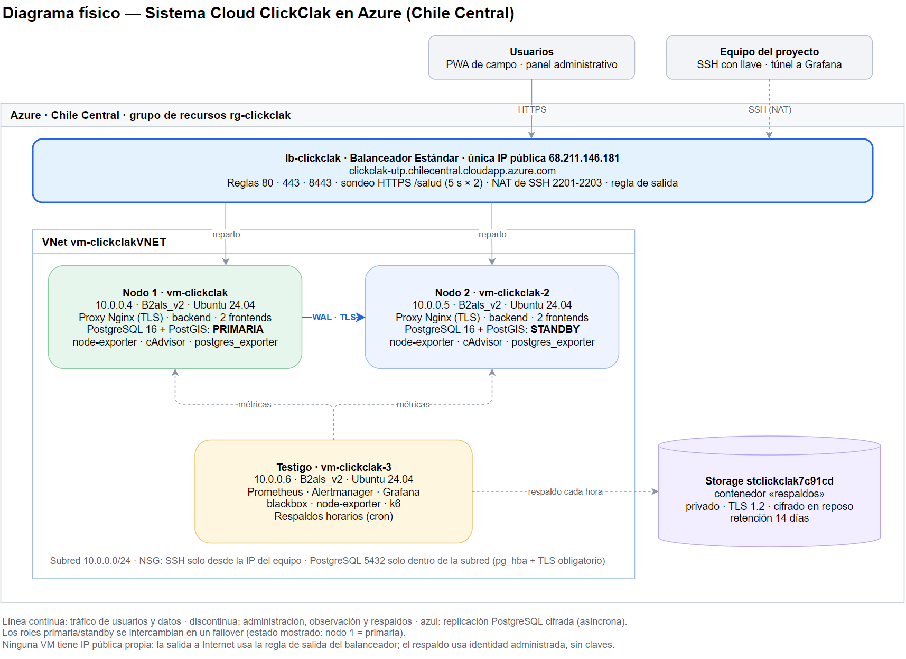
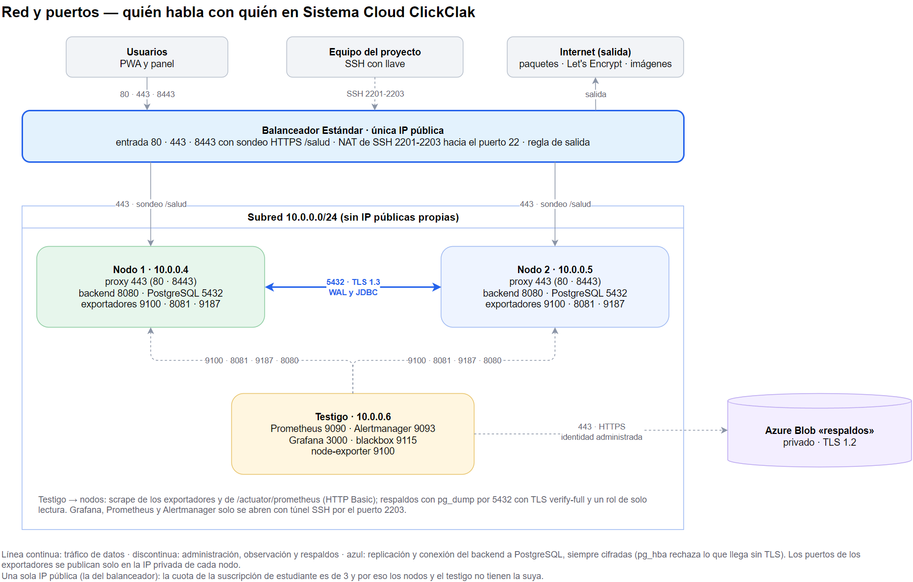

# CAPÍTULO III: CONTENEDORIZACIÓN, ORQUESTACIÓN Y RED (FASE 2)

## 3.1 Contenedorización

Cada servicio tiene su propio Dockerfile. Las decisiones de optimización y de seguridad de las imágenes se resumen en la tabla 1; los valores de tamaño y de consumo se **midieron en el nodo 1 en funcionamiento**.

@tabla Imágenes del sistema, sus decisiones de construcción y su consumo medido en el nodo 1
| Imagen | Construcción | Usuario | Comprobación de salud | Tamaño | Memoria en uso / límite |
|---|---|---|---|---|---|
| `clickclak-backend` | Dos etapas: JDK 21 compila, JRE 21 (Alpine) ejecuta; caché de BuildKit para las dependencias de Maven | `clickclak` (sin privilegios) | `curl` a `/actuator/health` cada 10 s | 436 MB | 343,6 MiB / 900 MiB |
| `clickclak-frontend-admin` | Dos etapas: Node 20 compila, `nginx-unprivileged` sirve en el puerto 8080 | 101 (sin privilegios) | `wget` a `/` | 96,5 MB | 3,2 MiB / 64 MiB |
| `clickclak-frontend-campo` | Igual que el anterior | 101 (sin privilegios) | `wget` a `/` | 96,4 MB | 3,1 MiB / 64 MiB |
| `clickclak-proxy` | `nginx:1.27-alpine` con paquetes al día y plantillas de configuración | — | — | 95,8 MB | 5,4 MiB / 128 MiB |
| PostgreSQL + PostGIS | Imagen oficial `postgis/postgis:16-3.4` | — | `pg_isready` | 853 MB | 58,1 MiB / 640 MiB |

El conjunto completo, con los exportadores de monitoreo, usa **1 290 MB de los 3 906 MB** de la VM, y el disco está al **29 % de 61 GB**. Todos los contenedores de aplicación y de base están en estado `healthy`.

**Decisiones de optimización**

- **Etapas separadas.** La imagen final del backend no arrastra el JDK ni los artefactos de compilación; los frontends no llevan Node, solo los archivos estáticos.
- **Caché de dependencias.** Con `RUN --mount=type=cache,target=/root/.m2` el repositorio de Maven se conserva entre construcciones sin formar parte de la imagen: cambiar solo el código ya no vuelve a descargar las dependencias.
- **Sin privilegios.** El backend corre como usuario `clickclak`, y los frontends usan la variante *unprivileged* de Nginx (por eso escuchan en 8080 y no en 80). Los contenedores de aplicación descartan todas las capacidades de Linux (`cap_drop: [ALL]`) y el proxy activa `no-new-privileges`.
- **`HEALTHCHECK` en cada servicio.** Compose y el sondeo del balanceador usan la misma comprobación; los servicios dependientes esperan a que sus dependencias estén `healthy`.
- **Límites de memoria por servicio** (tabla 1): un contenedor descontrolado no agota la VM.

```
# backend/Dockerfile (extracto)
FROM eclipse-temurin:21-jdk-alpine AS build
...
RUN --mount=type=cache,target=/root/.m2 ./mvnw -q -B -DskipTests package

FROM eclipse-temurin:21-jre-alpine
RUN apk add --no-cache curl && addgroup -S clickclak && adduser -S clickclak -G clickclak
COPY --from=build /app/target/backend-0.1.0-SNAPSHOT.jar app.jar
USER clickclak
HEALTHCHECK --interval=10s --timeout=5s --start-period=40s --retries=18 \
    CMD curl -fsS http://localhost:8080/actuator/health >/dev/null || exit 1
```

> **Un costo en tamaño.** Las imágenes de los frontends y del proxy incluyen una capa de actualización de paquetes del sistema (`apk upgrade`) que cierra vulnerabilidades de la imagen base (capítulo VI). La del proxy pesa 95,8 MB frente a 74,5 MB de `nginx:1.27-alpine`, unos 21 MB más; las de los frontends, 96 MB. Se priorizó la seguridad sobre el tamaño.

## 3.2 Orquestación multi-contenedor

Se eligió **Docker Compose** en lugar de Kubernetes. Es una decisión de diseño razonada, no una limitación del equipo: con dos nodos y un solo servicio de aplicación por nodo, el valor que aportaría un orquestador (planificación entre muchos nodos, escalado automático de réplicas) no se aprovecha, y su propio consumo sobre VM de 4 GiB competiría con la aplicación. La contrapartida es que el escalado entre nodos y la recuperación son manuales o guionizados (capítulos IV y V).

**Estructura de la orquestación.** Hay un archivo base común y un archivo por rol de nodo:

- `infra/docker-compose.prod.yml`: define los servicios (proxy, backend, dos frontends, PostgreSQL), las redes, los límites y las dependencias de salud.
- `infra/nodos/nodo1.yml`, `nodo2.yml` (y las variantes `nodo1-standby.yml`, `nodo2-primaria.yml`): fijan lo que cambia en cada nodo, como la IP privada en la que se publica PostgreSQL, la ranura de replicación y la cabecera `X-Nodo`. Ambos nodos usan **la misma URL de conexión** a la base, con los dos hosts en la lista:

```
jdbc:postgresql://10.0.0.4:5432,10.0.0.5:5432/clickclak
   ?targetServerType=primary&connectTimeout=3
   &sslmode=verify-full&sslrootcert=/certs/ca.crt
```

- `infra/scripts/desplegar.sh`: despliegue **idempotente**: crea los secretos aleatorios una sola vez (permisos 600, fuera de git), reconstruye lo que cambió y no toca los datos. Se ejecuta igual en ambos nodos.
- `infra/scripts/verificar-despliegue.sh`: prueba de humo del despliegue. Resultado: **69 comprobaciones correctas y 0 fallos en el nodo 1, y 66 y 0 en el nodo 2**, incluida la replicación cifrada entre nodos.

**Redes Docker.** Cada nodo tiene dos redes: `web` (proxy, frontends y backend) y `datos` (backend y PostgreSQL). El backend pertenece a ambas porque el proxy le reenvía las peticiones y él consulta la base. Los frontends solo ven la red `web`.

> **Matiz de seguridad.** La red `datos` **no es interna** (`internal: true`) a propósito: PostgreSQL se publica en la IP privada de la VM para que el otro nodo pueda replicar, y una red interna de Docker no admite puertos publicados. La protección de la base descansa entonces en la red virtual de Azure (sin IP pública), `pg_hba.conf` (autoriza solo a los nodos) y TLS obligatorio (capítulo VI), no en el aislamiento de Docker.

**Política de reinicio.** Todos los servicios usan `restart: unless-stopped`. Esto tiene una consecuencia que el diseño de failover debe controlar: si un nodo cae y vuelve, su PostgreSQL arrancaría como primaria. Por eso el procedimiento de recuperación **aísla** al nodo caído antes de promover otro (capítulo V).

## 3.3 Topología de red y seguridad cloud

**Componentes de red en Azure** (grupo de recursos `rg-clickclak`, región Chile Central):

@tabla Recursos de red y su función
| Recurso | Configuración | Función |
|---|---|---|
| Red virtual `vm-clickclakVNET` | 10.0.0.0/16, una subred 10.0.0.0/24 | Red privada de los tres servidores |
| Balanceador Estándar `lb-clickclak` | **Única IP pública**; reglas 80, 443 y 8443; sondeo HTTPS a `/salud` cada 5 s con 2 fallos | Reparte el tráfico entre los dos nodos y retira al que falla |
| Reglas NAT del balanceador | Puertos 2201, 2202 y 2203 hacia el 22 de cada servidor | Único camino de SSH, sin IP pública por VM |
| Regla de salida del balanceador | Grupo `be-salida` | Salida a Internet de los servidores (paquetes, certificados) |
| Grupo de seguridad de red (NSG) | SSH permitido solo desde la IP del equipo; PostgreSQL no se abre a Internet | Cortafuegos de las VM |
| Certificado TLS | Let's Encrypt para `clickclak-utp.chilecentral.cloudapp.azure.com`, el mismo en ambos nodos | Cifrado hacia el usuario |

**Por qué hay una sola IP pública.** La suscripción de estudiante admite como máximo **3 IP públicas**. Con tres servidores, dar una a cada uno habría agotado la cuota. El diseño quitó las IP públicas de los nodos y del testigo, y dejó **una sola en el balanceador**; los servidores salen a Internet por la regla de salida y se administran por SSH a través de las reglas NAT. Una limitación se convirtió en una mejora de seguridad: ningún servidor es alcanzable directamente desde Internet.

> **Sobre las subredes públicas y privadas que pide la guía.** El diseño usa **una sola subred**. La separación entre lo público y lo privado se logra por **asignación de IP** (solo el balanceador tiene IP pública) y por reglas del NSG, no por subredes distintas. Es una simplificación declarada; una segmentación en subredes por función sería el siguiente paso.

**Puerta de entrada (Nginx).** El proxy de cada nodo termina TLS, enruta por ruta (la PWA de campo en el puerto 443, el panel administrativo en el 8443, la API bajo `/api`), añade cabeceras de seguridad y la cabecera `X-Nodo` que permite ver qué nodo respondió, y aplica los límites de peticiones descritos en el capítulo V.

**Infraestructura como código.** El balanceador, el servidor testigo y los respaldos se crean con scripts de `az` versionados en `infra/azure/` (`balanceador.sh`, `testigo.sh` con `cloud-init-testigo.yaml`, `respaldos.sh`). **La red virtual, el NSG y los dos nodos de aplicación no tienen todavía script**: se crearon desde el portal y por clonado de un *snapshot* de la VM original. Reproducir el entorno desde cero exige, por ahora, esos pasos manuales (capítulo VII).

Los dos diagramas siguientes muestran la solución desplegada: primero la vista física en Azure y luego los puertos y flujos entre los servidores.

{paisaje}

{paisaje}

## 3.4 Ingeniería de plataforma: integración continua y despliegue

**Integración continua (GitHub Actions).** El repositorio tiene cinco flujos de trabajo con permisos de solo lectura sobre el código (`contents: read`). Los cuatro primeros solo corren cuando cambia su componente, y todos cancelan la ejecución anterior de un mismo *pull request* si llega un cambio nuevo.

@tabla Flujos de integración continua
| Flujo | Qué verifica | Falla si |
|---|---|---|
| `backend` | Compila con Java 21 y ejecuta las **329 pruebas** contra un PostgreSQL con PostGIS real (contenedor de servicio) | Una prueba falla |
| `frontend-admin`, `frontend-campo` | `npm ci`, compilación (TypeScript y Vite) y auditoría de las dependencias de producción; **los frontends no definen pruebas automáticas** | Hay vulnerabilidades altas o críticas en dependencias, o no compila |
| `infra` | Sintaxis de todos los scripts de shell y validación de los archivos de Compose | Un script o un compose es inválido |
| `seguridad` | Trivy sobre el código y las cuatro imágenes (capítulo VI) | Hay vulnerabilidades HIGH o CRITICAL no aceptadas por escrito |

**Despliegue.** Se hace con `infra/scripts/desplegar.sh` en cada nodo (sección 3.2). Las actualizaciones se aplican **un nodo por vez**: mientras uno se reconstruye, el balanceador mantiene el servicio con el otro, y se comprueba con la prueba de humo antes de pasar al siguiente. Los secretos se generan en la propia máquina y no entran al repositorio.

> **Lo que no hay.** No existe despliegue continuo: el despliegue es manual. Las imágenes se construyen en cada servidor y **no se publican en un registro** con etiquetas versionadas. La rama principal no tiene reglas de protección ni revisión obligatoria. Son mejoras naturales para un entorno de producción.

