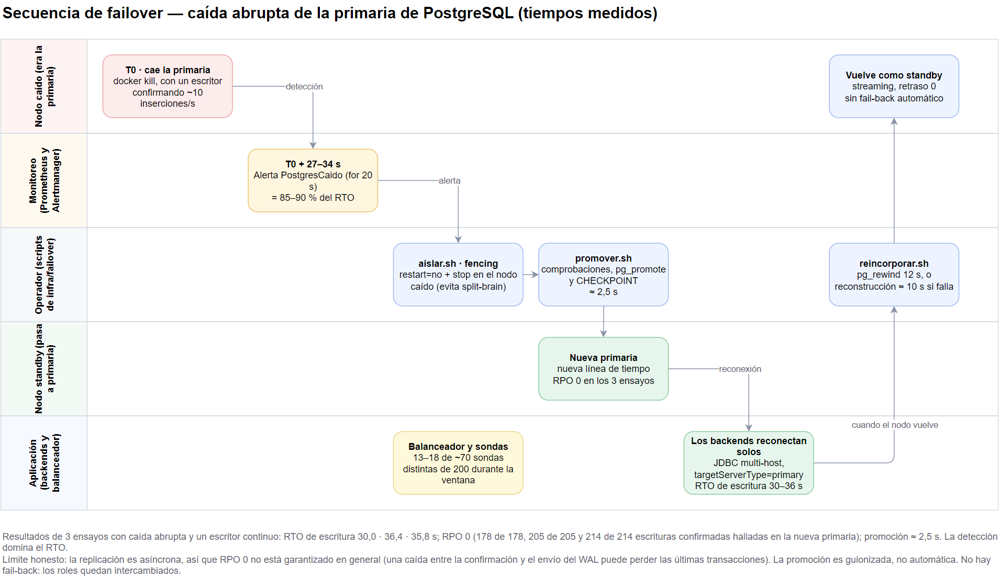
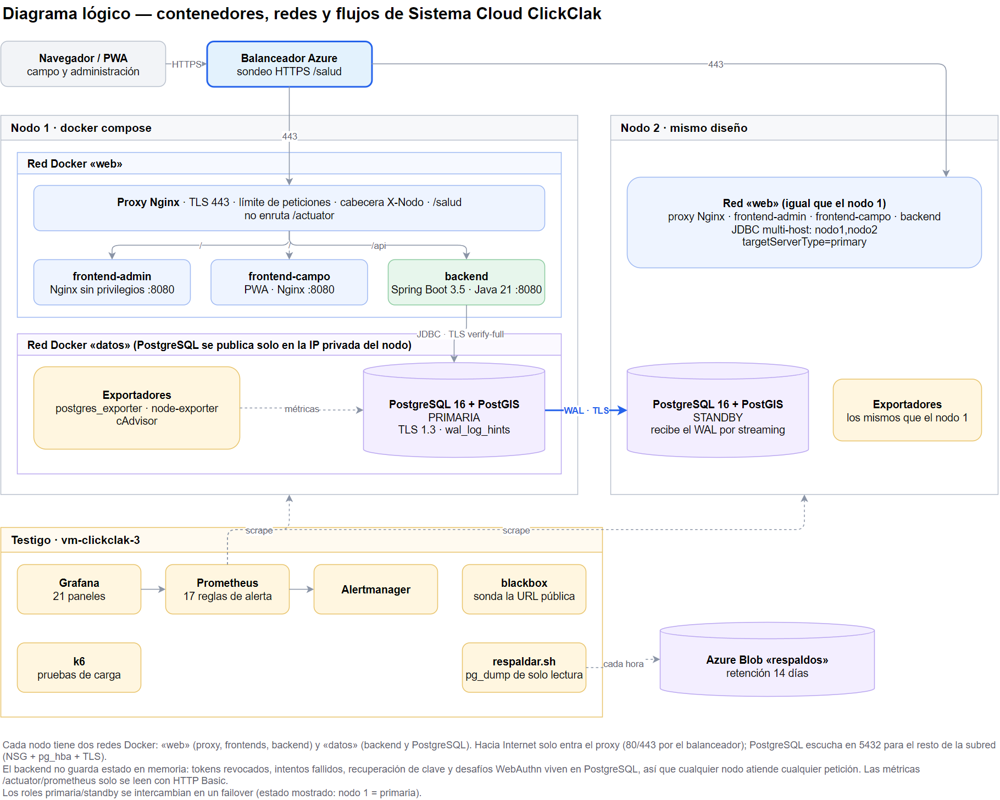

# 4. Fase 3: arquitectura cloud, resiliencia y alta disponibilidad

## 4.1 Patrones de diseño cloud

Se listan **solo los patrones que el código respalda**, con el archivo donde viven y cómo se comprobaron. Los que no se implementaron se declaran aparte.

@tabla Patrones aplicados, su ubicación y su verificación
| Patrón | Cómo se aplica | Dónde está | Verificación |
|---|---|---|---|
| **Health Endpoint Monitoring** | El proxy expone `/salud`, que consulta `/actuator/health` del backend (incluye el estado de la base). Lo usan el balanceador, `HEALTHCHECK` de Docker y las sondas externas | `infra/nginx/plantillas/ubicaciones-comunes.inc.template`; `backend/Dockerfile` | Caída de un backend: el balanceador lo retiró en ≈ 11 s (sección 4.3) |
| **Throttling (limitación de tasa)** | Límites por IP: inicio de sesión 10 por minuto, recuperación de clave 6 por minuto, API 20 por segundo con ráfaga de 40 y 40 conexiones simultáneas; responde 429 | `infra/nginx/plantillas/clickclak.conf.template` | Prueba P5: 45 % de 1 601 peticiones recibió 429 sin degradar el servicio |
| **Gateway Routing y Offloading** | Un único proxy por nodo termina TLS, enruta a los frontends y a la API, añade cabeceras de seguridad y la cabecera `X-Nodo` | `clickclak.conf.template`, `proxy-backend.inc.template` | Reparto verificado con `X-Nodo` |
| **Idempotent Receiver (receptor idempotente)** | Cada marcación lleva un identificador generado en el dispositivo (`uuidCliente`); si ya existe, el servicio devuelve la marcación registrada en lugar de duplicarla. La base lo refuerza con una restricción de unicidad | `MarcacionService.registrarMarcacion`; restricción `uk_marcacion_uuid_cliente` en `V1__esquema_inicial.sql` | Prueba P3: 2 000 envíos sobre 500 identificadores dejaron **486 filas distintas**, sin duplicados ni pérdidas |
| **Retry con cola local** (*offline-first*) | La PWA guarda las marcaciones en IndexedDB y las reenvía al recuperar conexión, contando los intentos y distinguiendo errores reintentables | `frontend-campo/src/offline/colaMarcaciones.ts` | Implementado; **no se ejercitó** en las pruebas en la nube |
| **Reconexión y failover del cliente de base de datos** | La URL de JDBC lista ambos nodos con `targetServerType=primary` y `connectTimeout=3`: el backend encuentra solo a la primaria tras una promoción | `infra/nodos/*.yml` | Failover real: ambos backends siguieron a la nueva primaria sin intervención |
| **Estado externalizado** (servicios sin estado) | Tokens revocados, intentos fallidos, recuperación de clave y desafíos WebAuthn viven en PostgreSQL, no en la memoria del proceso | `backend/.../security/Almacen*Jdbc.java`; migración `V5__estado_compartido_del_backend.sql` | 329 pruebas; sesión iniciada en un nodo válida en el otro (sección 3.2) |
| **Aislamiento por límites de recursos** (aproximación al patrón *Bulkhead*) | Límite de memoria por contenedor y de conexiones por pool, de modo que un componente desbordado no agota a los demás | `infra/docker-compose.prod.yml` | Los límites se aplicaron; no se provocó un agotamiento a propósito |

**No implementados, y se dice:**

- **Circuit Breaker** (interruptor de circuito): el backend no tiene uno. Las llamadas externas son pocas (geocodificación con tiempo límite de 3 s).
- **Queue-Based Load Leveling del lado servidor**: no hay un intermediario de mensajes. La cola local de la PWA amortigua ráfagas en el cliente, pero el servidor recibe las peticiones directamente.
- **Leader Election automática**: la promoción de la base es guionizada y manual (sección 4.6).

## 4.2 Backend sin estado compartido

Esta fue la brecha de código más delicada. En el curso anterior el backend guardaba **cuatro tipos de estado en la memoria de su proceso**: tokens revocados (cierre de sesión), contador de intentos fallidos (protección contra fuerza bruta), tokens de recuperación de clave y desafíos de WebAuthn. Con dos instancias, un cierre de sesión hecho en un nodo no valdría en el otro, y los intentos fallidos se contarían por separado, **duplicando el límite que protege las cuentas**.

La solución fue mover los cuatro a PostgreSQL con una migración (`V5`), definiendo para cada uno una interfaz (`Almacen*`) y una implementación JDBC, con expiración de los registros.

Tres decisiones merecen mención porque eran trampas reales:

1. **Escritura en una transacción independiente (`REQUIRES_NEW`).** El inicio de sesión corre en una transacción de solo lectura que se **revierte** al fallar. Si el intento fallido se registrara dentro de ella, la anotación se desharía y el límite de fuerza bruta quedaría anulado sin error visible.
2. **Los tokens se guardan como huella SHA-256**, no en claro: quien lea la tabla no obtiene tokens utilizables.
3. **WebAuthn** serializa los desafíos con las funciones `toJson` y `fromJson` de la librería, en lugar de guardar objetos de memoria.

El resultado se verificó con **329 pruebas automáticas** (incluidas pruebas de cada almacén contra una base real) y en vivo: el inicio de sesión se hizo en un backend y el token se usó en el otro durante las pruebas de carga.

## 4.3 Tolerancia a fallos: balanceo y redundancia

**Redundancia.** Hay dos nodos activos con los mismos contenedores. Ninguno es "de reserva": ambos atienden tráfico. La aplicación es idéntica en ambos y la base es una primaria y una standby.

**Balanceo y sondeo.** El balanceador Estándar sondea `https://<nodo>/salud` cada 5 segundos y retira de la rotación a un nodo tras **2 fallos** seguidos. Como `/salud` consulta el estado del backend y de la base, un nodo con la aplicación caída o sin acceso a una base primaria sale del reparto.

### Escenario 1: caída de un backend

Se detuvo el backend del nodo 1 mientras se enviaban sondas a la URL pública.

@tabla Resultado de la caída de un backend (evidencia: `docs/evidencias/caida-de-un-backend/`)
| Métrica | Valor |
|---|---|
| Sondas públicas totales | 191 |
| Sondas distintas de 200 | 5 (**97,4 % de éxito**) |
| Peticiones fallidas | ≈ 4, todas en los ≈ 10 s previos a que el balanceador reaccionara |
| El balanceador dejó de usar al nodo | ≈ 11 s |
| Durante la caída respondió | Solo el nodo 2 |
| El nodo vuelve al reparto | 17,3 s después de arrancar su backend |

El sistema **no se cae por la pérdida de un nodo de aplicación**: los ≈ 10 s de errores son el tiempo que tarda el sondeo en confirmar el fallo, el costo de elegir un sondeo cada 5 s con dos fallos (acortarlo aumentaría las falsas alarmas).

## 4.4 Replicación, failover y recuperación ante desastres

### Cómo se replica

La primaria escribe cada cambio en el registro de transacciones (WAL); la standby lo recibe por una conexión de replicación y lo reproduce (*streaming*). Una **ranura de replicación** hace que la primaria conserve el WAL que la standby aún no leyó, con un tope de 2 GiB. La replicación es **asíncrona**: una transacción se confirma en la primaria sin esperar a la standby. Esto da buen rendimiento, pero significa que el **RPO puede ser mayor que cero** si la primaria se pierde justo después de confirmar.

### Qué pasa si la standby asume y la primaria vuelve

Es el caso más peligroso y el que el diseño debe controlar:

@tabla Consecuencias de promover la standby y que la primaria original regrese
| Situación | Qué ocurre |
|---|---|
| Datos de la primaria que nunca llegaron a la standby | Existen solo en la primaria vieja; al reincorporarla se descartan |
| Datos escritos en la standby tras la promoción | Existen solo en ella: es la fuente de verdad |
| Reconectar la primaria vieja "tal cual" a la nueva | **Imposible**: las historias divergieron (líneas de tiempo distintas) y PostgreSQL lo rechaza |
| Ambas reciben escrituras a la vez | ***Split-brain***: dos verdades irreconciliables, el peor caso |

### Procedimiento de failover (scripts de `infra/failover/`)

1. **Detectar.** La alerta `PostgresCaido` se dispara.
2. **Aislar al nodo caído (*fencing*)** con `aislar.sh`: desactiva su reinicio automático y lo detiene. Es **obligatorio antes de promover**: con `restart: unless-stopped`, el nodo viejo volvería a arrancar como primaria. El script se niega a continuar si no logra detenerlo.
3. **Promover** con `promover.sh`: comprueba que el nodo es una standby, ejecuta `pg_promote` y un punto de control (`CHECKPOINT`), y deja lista la replicación hacia el nodo viejo.
4. **La aplicación sigue sola**: los dos backends ya listan ambos hosts con `targetServerType=primary`.
5. **Reincorporar** al nodo viejo con `reincorporar.sh`: intenta `pg_rewind` (lo rebobina al punto de divergencia) y, si falla, lo reconstruye con una copia base completa.
6. **Verificar** la replicación (`streaming`, retraso 0), `/salud` en 200 en ambos nodos y las alertas en calma.
7. **No hay *fail-back* automático**: los roles quedan intercambiados; volver al diseño original sería un cambio planificado, no una urgencia.

### Escenario 2: caída de la primaria (ensayos reales)

Se provocó una caída abrupta de la primaria (`docker kill`) mientras un escritor confirmaba unas 10 inserciones por segundo, y se midió cada fase.

@tabla Resultados de los ensayos de failover (evidencia: `docs/evidencias/failover-*/`)
| Ensayo | Cae | Detección | Promoción | **RTO de escritura** | Sondas públicas ≠ 200 | **RPO** | Reincorporación |
|---|---|---|---|---|---|---|---|
| 1 | Nodo 1 | 26,8 s | 2,6 s | **30,0 s** | 13 de 64 | **0** (178 de 178) | 9,7 s, reconstrucción |
| 2 | Nodo 2 | 33,9 s | 2,2 s | **36,4 s** | 18 de 72 | **0** (205 de 205) | 9,7 s, reconstrucción |
| 3 | Nodo 1 | 32,7 s | 2,7 s | **35,8 s** | 18 de 71 | **0** (214 de 214) | 12,3 s, **`pg_rewind`** |
| 4 (con TLS exigido) | Nodo 2 | — | — | **35,4 s** | — | **0** | **`pg_rewind`** correcto |

> **Cómo se definen las cifras.** El **RTO** es el mayor hueco entre dos escrituras confirmadas consecutivas, desde la última anterior a la caída hasta la primera tras la promoción. La **detección** es el tiempo hasta que la alerta se dispara. El **RPO** es cuántas escrituras confirmadas al cliente no se encontraron en la nueva primaria.

{paisaje}

**Lecturas.**

- **La detección domina el tiempo de recuperación**: es el 85–90 % del RTO. La promoción en sí tarda unos 2,5 s. Bajar la duración de la alerta de 20 a 10 s recortaría el RTO, a costa de más falsas alarmas.
- **RPO 0 en cuatro de cuatro ensayos, pero no está garantizado.** La replicación asíncrona puede perder las últimas transacciones si la caída ocurre entre la confirmación y el envío del WAL. Las pruebas se hicieron con carga ligera (unas 10 escrituras por segundo) y base pequeña; no son una garantía.
- **Mientras no hay primaria, el servicio público se cae**: el sondeo `/salud` incluye el estado de la base, así que ambos nodos fallan el sondeo y el balanceador deja de entregar tráfico nuevo hasta que se promueve una primaria (de 13 a 18 de unas 70 sondas fallaron en los ensayos).
- **El detector de *split-brain* existe**: las alertas `SinPrimaria` y `DosPrimarias` vigilan que haya exactamente una primaria.

**Lecciones técnicas del ensayo** (incorporadas a los scripts):

1. **`pg_rewind` lee el archivo de control, no el parámetro.** Activar `wal_log_hints` y reiniciar no basta: hace falta un `CHECKPOINT` previo. Los dos primeros intentos de `pg_rewind` fallaron por eso y la reincorporación cayó a la reconstrucción completa; después se corrigió y funcionó.
2. **La recuperación tras una caída abrupta puede deshacer esa configuración**: el modo de arranque monousuario reescribió el archivo de control con el valor por defecto hasta que se le pasó `-c wal_log_hints=on`.
3. **Medir mal también cuenta.** La primera versión del ensayo informó un RTO de 0 s porque tomaba la primera escritura tras la caída en lugar del hueco; se corrigió y las cifras de arriba son las recalculadas.

## 4.5 Respaldos y restauración

**Por qué hacen falta aunque haya réplica.** La réplica copia también un borrado equivocado: no es un respaldo. Se comprobó: se creó una tabla de 1 000 filas, se respaldó, se ejecutó `DROP TABLE` en la primaria y **la standby también perdió la tabla**; la restauración desde Azure Blob la devolvió con sus 1 000 filas.

@tabla Diseño y resultados de los respaldos (evidencia: `docs/evidencias/respaldo-y-restauracion/`)
| Aspecto | Valor |
|---|---|
| Frecuencia | Cada hora (cron en el testigo) y prueba de restauración los domingos |
| Método | `pg_dump` con un rol **de solo lectura**, leyendo de la standby para no cargar a la primaria |
| Destino | Azure Blob, contenedor privado, cifrado en reposo, sin acceso público |
| Credenciales de subida | **Identidad administrada** del testigo con permiso mínimo sobre un solo contenedor; no hay claves de almacenamiento ni firmas SAS en ninguna VM |
| Integridad | Huella SHA-256 junto a cada respaldo; la restauración **rechaza** un respaldo manipulado (probado) |
| Retención | 14 días, por política de ciclo de vida de la cuenta |
| Tamaño y duración | ≈ 67 KB comprimido; ≈ 1,1–1,4 s el volcado y ≈ 0,1–0,2 s la subida |
| Restauración medida | 1,7 s la restauración y **9,4–9,5 s en total** con el arranque de una base descartable |
| Verificación | 14 tablas con **conteos iguales** a producción y PostGIS 3.4.3 |

> **Sobre los resultados de comparación.** En el escenario del borrado accidental la comparación de conteos da "diferentes", y **es lo esperado**: la copia restaurada contiene la tabla recuperada, que producción ya había perdido. La comparación de 14 tablas "iguales" corresponde a una restauración sobre un respaldo reciente sin ese cambio. Ambas están en el repositorio.

El **RPO por respaldo** es de hasta 1 hora y el **RTO por respaldo** de unos 10 s con esta base pequeña, más el tiempo humano de decidir y apuntar la aplicación. Son respaldos **lógicos** (`pg_dump`): restaurar recrea la base, no la reincorpora al clúster, y no hay archivado continuo del WAL, así que **no permiten recuperar a un instante exacto**.

## 4.6 Limitaciones y mejoras

@tabla Limitaciones declaradas y su mejora natural
| Limitación | Efecto | Mejora |
|---|---|---|
| Replicación **asíncrona** | RPO mayor que cero posible | Replicación síncrona (a costa de bloquear escrituras si la standby cae) o aceptar y documentar el RPO medido |
| **Promoción manual** guionizada | RTO de ≈ 30–36 s con una persona, y depende de que alguien actúe | Gestor automático (Patroni con etcd, o pg_auto_failover) con **quórum**: exigiría que el testigo fuera un votante, hoy no lo es |
| Testigo sin voto de quórum | Con dos nodos y un tercero sin base no hay mayoría para decidir solo | Convertir al testigo en miembro de quórum |
| Base y aplicación comparten servidor | Compiten por la CPU; una falla del nodo afecta a ambas | Servidor de base de datos propio |
| Respaldos lógicos cada hora, sin WAL | Sin recuperación a un instante exacto (PITR) | Archivado continuo de WAL a Blob |
| Sin zonas de disponibilidad | Los nodos no están en zonas distintas | Recrear los nodos en zonas distintas (exige recrear desde un *snapshot*) |
| Una sola región | Una caída regional no se cubre | Réplica o respaldo en otra región |
| VM de la serie B | Rendimiento limitado si se agotan los créditos de CPU; **no se pudo comprobar** | VM de uso general o métrica de créditos |

## 4.7 Diagrama lógico

Los diagramas físico y de red (figuras 1 y 2) están en la sección 2.3, y la secuencia de failover (figura 3) en la sección 4.4. Todos están en `docs/diagramas/` en formato editable (`.drawio`) y como imagen.

{paisaje}
